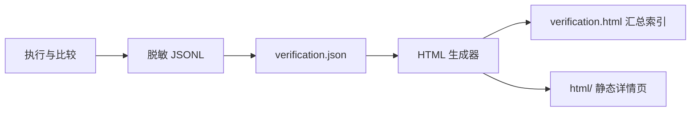

# 阶段二：双库 SQL 执行与结果比较设计

文档类型：设计文档。

导航：[总体设计索引](./阶段方案索引.md) · [阶段一：SQL 提取设计](./阶段一-SQL提取能力与独立工程.md) · [阶段三：清单生成与覆盖设计](./阶段三-场景与运行覆盖规划.md)

本文定义双库验证的输入契约、执行流程、比较规则、事务恢复及报告设计。流程描述用于约定组件行为，不代表开发排期或验证完成状态；构建、启动及具体配置操作见[验证器说明](../sql-verifier/README.md)。

## 1. 目标与范围

双库验证器将同一条 SQL 和同一组固定参数分别用于两个数据源，检查数据库切换后的执行行为与结果兼容性。查询使用独立查询清单；受控写入使用独立 DML 用例，两侧各自执行、回查并无条件回滚。输入由阶段三生成器、人工或其他工具提供，验证器不依赖清单的生产方式。

| 验证模式 | 输入 | 输出 | 依赖边界 |
| --- | --- | --- | --- |
| 查询 | 固定查询 SQL 与有序参数、双侧数据源及比较声明 | 执行证据、结果范围及比较结论 | JDBC 驱动与可确认的数据基线，无需业务源码、Mapper、DTO 或 MyBatis |
| 受控 DML | 固定写入 SQL、参数、回查及前后预期 | 写入、断言、双侧比较与恢复报告 | 专用受控数据、明确表权限和可确认的事务条件 |

本方案覆盖 JDBC 查询结果与受控单条 DML 的事务内行为。查询对比关注相同输入下的执行结果与比较范围；DML 通过显式回查、预期断言、回滚和恢复检查验证写入行为，见[第 8 节](#8-受控-dml-验证)。

范围不包含成功提交、XA、自动补偿、数据同步、复杂业务事务、存储过程、业务插件执行及 Mapper/API 返回行为。自动采样、更多参数场景和运行 SQL 捕获由[阶段三方案](./阶段三-场景与运行覆盖规划.md)定义。

目标环境为 MySQL 8.0.x 和 YashanDB Enterprise Edition 23.4.14.100 x86_64，YashanDB 采用 MySQL 兼容模式。数据库、驱动和版本组合须通过对应环境验证，协议元数据不能作为原生数据库版本的证明。

## 2. 工具职责与工程结构

```text
提取结果 → 清单生成器 ──────────┐
                              ↓
手工或其他工具 ─────→ 查询清单／DML 用例
                              ↓
                        双库 SQL 验证器
                              ↓
                   执行、比较与恢复判定
                              ↓
                verification.json / verification.html
```

提取器负责发现定义与保留模板；生成器负责模板求值、参数依据、场景选择及清单导出。验证器只消费清单中的 SQL 与类型化参数，负责筛选、JDBC 绑定、两侧执行、结果比较和报告，不构建业务项目，不复用提取器配置与业务 classpath 准备流程。

DML 用例既可人工维护，也可由生成器准备，执行时统一接受验证器的环境与输入检查。验证器复用参数编解码、结果读取和报告能力，不依赖 Spring、连接池或分布式事务。查询会话与线程池只处理查询，DML 由独立执行路径管理每侧的短连接和本地事务；比较模块只处理证据，不管理连接。

查询链路内部通过明确类型传递执行与比较证据：`QuerySideResult` 复用 `QueryExecution` 保存已执行结果，并单独表达未执行原因；`QueryComparison.Result` 区分比较模式、读取范围、观察状态与最终结论。连接所属线程完成比较和报告值转换后，以 `ComparedQuery` 交付报告载荷及统计依据；调用线程仅在落盘成功后累计统计，不从报告字段反推业务状态。JSON 字段由报告转换方法显式组装，内部类型不直接作为新的 JSON 结构输出。

组件职责与依赖如下：

| 模块 | 职责 | 依赖边界 |
| --- | --- | --- |
| `sql-query-contract` | 查询及 DML 用例模型、编解码和格式校验 | 不依赖 MyBatis、Spring 或数据库驱动 |
| `sql-extractor` | SQL 提取、条件展开与提取诊断 | 依赖契约模块，按提取来源加载业务 classpath |
| `sql-manifest-generator` | 参数解析、只读采样、场景选择与执行清单生成 | 根工程子模块，通过项目依赖复用契约，不依赖验证器实现 |
| `sql-verifier` | JDBC 执行、结果比较、报告与验证入口 | 依赖契约模块和 JDBC 驱动，不加载业务项目或提取器 |

业务处理组件通过文件衔接，互不依赖内部实现。验证器的独立运行环境仅包含自身依赖及 JDBC 驱动，业务 classpath 不进入执行环境。

## 3. 查询清单格式

清单只保留执行所需的信息，顶层为 `queries` 数组，每个条目包含 `id`、`sql` 和可选的 `parameters`。完整文件见[查询清单示例](../examples/verifier/queries.example.json)。

```json
{
  "queries": [
    {
      "id": "patient.findById",
      "sql": "SELECT id, name FROM patient WHERE id = ?",
      "parameters": [
        { "jdbcType": "VARCHAR", "value": "P001" }
      ]
    },
    {
      "id": "patient.count",
      "sql": "SELECT COUNT(*) FROM patient"
    }
  ]
}
```

示例表和字段仅用于说明格式，实际使用前需按测试环境修改；示例不包含建表、数据同步或数据库验证结果。

### 字段规则

| 字段 | 要求与含义 |
| --- | --- |
| `queries` | 必填数组；空数组表示没有待执行查询，报告不得统计为验证通过 |
| `id` | 必填非空字符串，清单内唯一；用于筛选、配置覆盖和报告定位 |
| `sql` | 必填非空字符串，已经展开的单条查询 SQL；参数占位符使用 `?` |
| `parameters` | 可省略，默认为空数组；数组顺序对应 SQL 中的参数占位符 |
| `jdbcType` | 每个参数必填，使用本节支持的大写类型名；显式 `null` 仍须指定类型 |
| `value` | 每个参数必填，允许显式 `null`；缺少字段属于错误，不按 `null` 处理 |

参数位置由数组顺序确定，不保存 `position`。占位符校验须排除字符串、标识符和注释里的字面量问号，不能直接统计所有 `?` 字符。

清单不包含版本号、来源对象、Java 类型、TypeHandler 类名、比较规则和扩展字段。未知字段报错，避免拼错字段后被静默忽略。文件结构无效、ID 重复等清单级错误在连接数据库前终止本轮；单条 SQL 或参数无效则记录该条未执行的原因，其他有效查询继续处理。

### 参数编码

参数支持以下类型，每种类型均允许显式 `null`，不做自动类型猜测：

| `jdbcType` | 非空 `value` 编码 |
| --- | --- |
| `VARCHAR` | JSON 字符串 |
| `INTEGER` | JSON 整数，须在 32 位有符号整数范围内 |
| `BIGINT` | 十进制整数字符串，须在 64 位有符号整数范围内 |
| `DECIMAL` | 十进制字符串，例如 `"12.50"`，不通过浮点数中转 |
| `BOOLEAN` | JSON 布尔值 `true` 或 `false` |
| `DATE` | 日期字符串，例如 `"2026-10-09"` |
| `TIME` | 时间字符串，例如 `"09:30:00"`，可带小数秒 |
| `TIMESTAMP` | 不带时区偏移的日期时间字符串，例如 `"2026-10-09T09:30:00"`，可带小数秒 |

日期和时间使用 ISO 本地日期时间格式，校验实际日期、时间及精度，不接受任意字符串或自动猜测时区。两库会话时区等条件应记录并对齐。其他 JDBC 类型、复杂对象、数组、二进制、流和驱动专属对象不在支持范围，明确记录原因。

### 查询标识与诊断

执行 ID 在清单内唯一，不要求 Mapper 命名，也不由验证器重新编号。手工清单可自行命名；生成器基于固定执行输入确定稳定 ID，规则见阶段三设计。ID 与本轮报告序号分别承担身份和展示定位职责。

原定义与提取错误保存在 `sql.json`、`errors.json`；生成器在覆盖报告中保存执行 ID、原定义、场景及未导出原因的关联。验证器不要求加载这些诊断文件，报告以清单 ID 为定位依据。

## 4. 清单生产侧与验证侧的参数边界

清单生产侧负责取得最终 SQL 及与其对应的固定参数。动态 XML 求值后的普通参数、`foreach` 和 `bind` 附加值按真实参数映射顺序解析，转换为契约支持的类型和值。两库重复使用同一份逻辑输入，不在执行时生成参数或重新求值模板。

业务 TypeHandler 等转换只有在生产侧具备可靠资料及支持的转换依据时，才能固定为契约值。显式 JDBC 参数可以表达执行输入，但不能据此声称恢复了原业务 TypeHandler 行为。依赖真实连接的转换、驱动专属对象及无法无损编码的值形成生产侧缺口，验证器不加载业务类补猜。

`all.sql`、提取 JSON 及诊断用于阅读与定位；独立执行清单必须同时具备最终 SQL 和完整有序参数。模板、写入和未解析源码片段不能混入查询清单。原参数冻结、多场景求值与覆盖选择由阶段三定义，阶段一参数模式保持自身职责。

## 5. 查询验证配置与执行

验证配置与查询清单分开，包含清单路径、两个数据源、查询 ID 筛选、超时、结果值体积限制和报告输出位置。路径按所属配置目录解析，凭据通过外部引用提供，避免执行输入耦合环境和密码。具体配置见[公开示例](../config/verifier/verification.example.json)与[验证器说明](../sql-verifier/README.md)。

| 配置 | 规则 |
| --- | --- |
| `queries`、`output` | 必填，分别为清单文件和报告父目录 |
| `rows` | 默认 30，正整数，作为本轮全局行数上限 |
| `concurrency` | 查询默认 16，整数 1 至 32；实际工作线程数不超过所选有效查询数，1 保持串行 |
| `queryIds` | 可省略或空数组，表示全清单；非空时精确筛选，未知或重复 ID 报错 |
| `comparison` | 可省略；`orderedQueryIds`、`stableRangeQueryIds`、`expectedEmptyQueryIds` 三个数组均默认空，精确声明查询 ID，见第 7 节 |
| `queryTimeoutSeconds` | 默认 30，正整数，传给 JDBC 查询超时 |
| `maxResultBytes` | 默认 5242880，每条查询每侧结果值的 UTF-8 字节限额，包含 null，不包含 JSON 格式和列元数据 |
| `datasources.source`、`datasources.target` | 均必填，包含 `driverClassName`、`jdbcUrl`、`username` |
| `passwordEnv`、`passwordFile` | 每个数据源必须且只能选择一个外部密码引用，密码不能为空 |
| `connectTimeoutMillis`、`socketTimeoutMillis` | 数据源内默认 10000 和 30000，传给驱动的连接与网络读取超时属性 |

输入先校验后连接，配置与清单拒绝未知字段。JDBC URL 不允许携带用户名或密码，报告、配置诊断与错误记录隐藏配置密码。连接超时属性按 [Connector/J 网络属性](https://dev.mysql.com/doc/connector-j/en/connector-j-connp-props-networking.html)处理，其他驱动是否支持须另行确认；查询超时同样取决于实际驱动。

查询范围检查接受保守识别的单条 `SELECT` 和查询型 `WITH`，跳过普通注释与引号内的字面量问号。拒绝多语句、修改或锁定类关键字、未展开模板、可执行注释和优化器提示，并校验实际占位符数与有序参数数量。此检查不是完整方言解析器，不能保证识别全部查询或证明查询没有副作用；应使用查询权限测试账号，连接只读提示不代替权限限制。

逐条使用实际 `PreparedStatement` 按清单类型绑定，不执行拼接后的展示 SQL。参数只解码一次，两侧重复使用同一逻辑值。清单级错误终止启动，逐条输入错误记录未执行原因，其他有效查询继续处理；空清单或无有效查询时不连接数据库。连接不可用时，该侧后续条目标记未执行，不重新逐条连接。

### 查询线程池与落盘确认

并发仅用于互相独立的查询；依赖执行顺序、连接内变量或会话状态时保持串行。多个连接不提供同一事务快照，仍需确认两库数据稳定与会话条件一致。受控 DML 不进入查询线程池，按第 8 节使用独立事务连接及 `concurrency: 1`。

实际并发数 C 为 `concurrency` 与所选有效查询数的较小值；C 为 0 时不建连，为 1 时直接串行。C 大于 1 时仅向固定大小 `ThreadPoolExecutor` 提交 C 个长期工作任务，各线程复用自己的一对 source/target 连接，共至多 2C 条连接，不为整份清单逐条提交任务或累计 Future。


1. 主线程完成预检、编号和输入错误落盘；工作线程各自初始化连接，主线程收齐初始化状态后统一放行。
2. 工作线程通过原子游标领取一条查询，先执行 source，再执行 target，两侧使用同一份固定参数，随后在所属线程比较行值。
3. 完整结果进入容量为 C 的队列，主线程调用 `ExecutionReportWriter.append()`，同步文件成功后更新统计并确认；该工作线程收到确认才领取下一条。
4. 主线程持续消费，全部结果落盘且工作线程、线程池实际结束后核对数量，再流式生成最终报告。不能先等待 worker Future 完成再消费，也不能仅凭队列为空判定完成。

主线程独占写入器，接收函数中的写入错误直接传播。领取、入队和确认等待均检查停止状态；采用有界队列和可中断等待，提交拒绝终止整轮，不用可能占住主线程的 `CallerRunsPolicy`。参见 [JDK 17 ThreadPoolExecutor](https://docs.oracle.com/en/java/javase/17/docs/api/java.base/java/util/concurrent/ThreadPoolExecutor.html)。

每个工作线程最多持有一条未确认查询，全局最多 C 条。若每侧结果值限额为 B，在途结果值预算约为 `C × 2B`，并非堆内存上限；还需容纳完整输入清单、对象与列信息、单条脱敏/序列化副本及驱动缓存。并发数同时影响连接数、写盘等待、峰值内存和数据库负载，增加并发不保证提高吞吐。

### 连接失效与运行停止

连接、语句和结果集由所属工作线程管理，主线程不借用连接执行或关闭。停用仅标记不可用，连接在工作线程 `finally` 中关闭，避免关闭阻塞妨碍结果交付。

| 情况 | 处理规则 |
| --- | --- |
| 单条绑定、执行或读取失败 | 保存实际错误，另一侧和后续查询继续；完整报告按退出码 2 返回 |
| 某侧任一初始化连接失败 | 放行前将该侧整体停用，全部有效查询该侧记为未执行，另一侧继续；不自动降低并发或重连 |
| 某侧运行中出现 SQLState `08` | 原子发布首次失效原因及触发 worker/查询，后续该侧引用同一原因并记为未执行；已取得执行资格的调用保留实际结果，另一侧继续，不重试 |
| 调度、工作任务或写盘异常 | 停止领取、释放初始化等待、使落盘确认异常完成并取消工作任务；保留已同步 JSONL，退出码 1，不生成正常完成报告 |

并发正常收尾与错误清理共享一次最多 30 秒的等待期限；正常轮次从全部结果落盘后计时，串行由执行线程关闭连接。只统计实际进入的工作任务，关闭操作完成后才减少存活计数；初始化等待还须检查失败与取消，避免等待永远不会到达的握手。清理必须确认线程池实际终止，关闭警告单独记录，不覆盖查询错误。

线程中断和 `shutdownNow()` 仅尽力取消，不能保证立即终止 JDBC 调用或服务器端查询。超时明确报告清理未完成并按退出码 1 结束；查询与网络超时仍取决于驱动支持。参见 [JDK 17 ExecutorService](https://docs.oracle.com/en/java/javase/17/docs/api/java.base/java/util/concurrent/ExecutorService.html)。执行范围不包含续跑、进度显示、自动重连或主动 `Statement.cancel()`。

### 独立运行包

验证器以独立运行包交付，包含跨平台启动脚本、自身运行依赖、额外驱动目录、公开配置与清单示例及首次使用说明。运行环境需要 Java，但不包含提取器、业务 classpath 或本地凭据。

驱动依赖与工具依赖分别管理，避免业务项目依赖进入验证环境或同一驱动多个版本混用。查询、比较、受控 DML 和退出状态由同一执行入口承载。构建与启动方式见[验证器说明](../sql-verifier/README.md#获取运行包)，运行包可启动不代表具体数据库组合已通过兼容性验证。

## 6. 数据基线与结论前提

| 验证目标 | 数据要求 | 可以形成的结论 |
| --- | --- | --- |
| 查询执行检查 | 查询涉及的表、字段等结构可用，数据可以不同 | 本次 SQL 和参数是否执行成功 |
| 结果一致性比较 | 本次查询涉及的数据已对齐，比较范围和执行条件可确认 | 本次范围内一致或存在差异 |

无需先同步全部业务数据，可以从两库相同的小型受控数据集开始。关联查询须覆盖相关表；验证期间保持数据稳定，避免两侧执行之间发生数据变化。时区等会话条件应对齐，当前时间、随机数等非确定性表达式须单独评估。

验证器默认按两库数据基线一致进行比较，不设置额外的基线确认字段。完整且可比较的结果按实际行值判为 `MATCH` 或 `DIFFERENT`；排序、完整读取、行内值可比较和空结果覆盖仍独立判断。

验证器不自动同步数据，也不自动证明基线一致。数据基线一致的默认前提适用于本轮选中的全部查询。DML 另须通过每侧实际前置回查断言，回滚只恢复各自原状，不会修复两库原有差异。

## 7. 结果范围与比较规则

### 比较前提与单位

查询比较以两库表结构、列名及同一 SQL 返回的行结构一致为前提，直接比较行数据。列数、列名、列顺序及 JDBC 列元数据不作为独立校验项，不配置表名或列名映射，也不根据列信息决定是否进入比较。

每行视为完整的值列表，例如 `[1, "张三", null]`，按整行内容判断等价。无序比较匹配整行并保留重复次数；顺序比较按结果集返回顺序逐行匹配。行内值保持原有排列，不按列名重新配对。列元数据继续用于结果读取和诊断展示，不参与行比较结论。

### 结果读取

两库执行原 SQL，分别保存前 `rows` 条；额外探测第 `rows + 1` 条，仅用于记录 `hasMore`，不保存探测行字段。不足 `rows` 条或恰好返回 `rows` 条时，都需确认结果已耗尽。结果按列位置保存，保留重复别名、类型、SQL null 和高精度数值。读取失败可能保留已完整读取的行，此时不能认为结果已经耗尽。

JDBC 设置最多返回 `rows + 1` 行，保留一行用于探测。工具保存前 `rows` 行结果值；这不保证减少数据库内部扫描、排序或聚合工作，`maxResultBytes` 也不能保证单个字段的驱动内部缓存受此限额控制。

### 查询结果比较

串行与并发执行均在双侧执行后、脱敏和落盘前进行行比较；查询比较器不复用 DML 的列类型断言。默认无序，比较声明位于验证配置，清单格式保持不变：

```json
{
  "comparison": {
    "orderedQueryIds": ["patient.orderedList"],
    "stableRangeQueryIds": ["patient.orderedList", "patient.page"],
    "expectedEmptyQueryIds": ["patient.noMatch"]
  }
}
```

三个数组省略时为空，必须为非空字符串且 ID 不重复，并在连接前核对完整清单；允许保留本轮未选中查询的声明。`orderedQueryIds` 指定按行顺序比较；`stableRangeQueryIds` 确认稳定排序与相同取数范围；`expectedEmptyQueryIds` 断言应为空，在基线、范围及读取条件成立时任一侧非空判为差异。此配置仅用于查询，DML 模式拒绝它。

有后续数据时结论限定为“前 N 条一致”；两侧均耗尽时才可说明本次查询的完整结果范围。超时、读取失败或结果体积保护导致中断时属于比较未完成。仅依靠 JDBC 行数上限丢弃后续记录，不能据此判定 `hasMore`。客户端限行主要控制传输、内存和比较成本，不保证数据库内部减少扫描、排序或聚合工作。

取前 N 条时要求稳定排序，建议排序末尾包含唯一键。SQL 存在 `ORDER BY` 本身不能证明排序稳定；比较同时要求外层 `ORDER BY` 和 `stableRangeQueryIds` 声明，不解析或推断唯一键。不能确认相同范围时记录“采样范围不确定”，即使观察值相同也不能判定通过。对于分页 SQL，即使已读完该页，也要确认分页范围稳定。两侧确已返回同一完整结果范围时，可以进行无序比较。范围记录为 `FULL/PAGE/PREFIX/UNKNOWN`；分页识别保守检查任意层级的 `LIMIT/OFFSET/FETCH/TOP`，跳过引号与普通注释，内层排序不算外层排序。未识别的分页写法需自行核实范围，此检查不是完整方言解析。

| 情况 | 比较规则或结论 |
| --- | --- |
| 普通列表 | 范围确定后无序匹配整行，并保留重复行的次数 |
| 顺序敏感查询 | 按返回顺序比较完整行值列表，要求稳定排序 |
| 分页 | 比较该页记录；总数查询为独立条目，不自动生成 count SQL |
| 聚合 | 比较实际返回值，`COUNT=0` 与空结果集分别处理 |
| 两边为空 | 默认记录空结果一致、内容覆盖不足；明确预期为空时按断言判断 |
| 一侧或两侧失败 | 记录执行失败，相同报错也不算通过 |
| 不能完成指定范围读取 | 比较未完成，保留原因与已读取数量 |
| 行内值不能可靠比较 | 标记无法比较，不用 `toString()` 猜测值等价；列类型声明差异不单独阻止比较 |

整行等价由行内值的等价规则决定：数值按数值比较，允许 `1.0` 与 `1.00` 等值；字符串保留大小写和尾空格，区分 `NULL` 与空字符串；日期时间保留本地值类别及小数秒精度，精确匹配；不自动转换时区或猜测日期文本类别，会话条件需事先对齐。值的等价处理不核对两侧 JDBC 列类型声明，列名、别名和驱动类型名称的差异只作为诊断信息展示。

## 8. 受控 DML 验证

目标是验证一条写 SQL 在两库中的事务内行为；成功和失败均回滚，不保留测试修改。每个用例独立，不支持多步骤编排、写入并发、自动推导回查 SQL、重试、重连或中断续跑。

UPDATE 的整组 WHERE 条件允许一层外括号，例如 `UPDATE demo_order SET status=? WHERE (id=?)`，用于接收 MP Wrapper 结构；原有唯一键、条件语法与恢复检查保持不变，不支持 OR 或任意嵌套表达式。

### 测试环境与 SQL 范围

使用指定专用测试库、限定表权限账号及两侧相同的小型数据集；验证期间相关数据保持稳定，结构、约束和会话条件符合第 6 节前提。实际表和驱动的本地事务及回滚行为必须能够确认，`supportsTransactions()` 不能代替具体表行为依据；触发器、级联及外部副作用未确认时不进入用例集。

| 类型 | 允许范围 |
| --- | --- |
| `INSERT` | 单表、显式列名、单行 `VALUES`、固定主键；不依赖生成键或非确定性默认值 |
| `UPDATE` | 单表，主键/完整唯一键等值定位，可通过 AND 增加固定条件；不修改定位键 |
| `DELETE` | 禁止执行；建连前记录 `NOT_EXECUTED/INPUT`，继续其他有效用例 |
| 回查 | 显式提供的无副作用查询，完整覆盖约定记录与字段；不通过聚合或 `LIMIT` 隐藏范围 |

DML 范围检查与 `QueryGuard` 分开，解析操作类型、目标表和条件结构，核对 `allowedTables` 及实际主键/唯一键元数据；复合键须覆盖全部列，表名按实际 catalog/schema 精确解析，不能仅匹配后缀。拒绝 OR 条件、多语句、DDL、事务控制、可执行注释、存储过程、冲突更新、多表修改、子查询写入、批处理及函数调用等未支持语法；无法确认时不执行。仅看到 `WHERE` 或主键条件不构成放行依据。

实际语法检查以参数化值与等值定位为基础，不接受注释；UPDATE 额外支持精确数值列的有符号 64 位整数固定赋值，以及 AND 连接的 `列 IS NOT NULL`、`列 != 整数`（或 `<>`）附加条件；除下述同列加一和受控 IN 外，不支持字符串/小数字面量、函数、其他计算表达式、OR 或其他批量写入。等值路径的完整定位键仍必须通过非空 `?` 参数确定，固定赋值不能修改定位键，回查必须覆盖固定赋值字段且不能附带业务过滤条件。标识符为普通 ASCII 名称或反引号形式。回查限定为同表显式列 SELECT，条件恰好为一个完整定位键，必须投影定位键和所有显式写入字段，并使用与写入相同类型、相同非空参数，可附加字段 ORDER BY；不接受星号、别名或额外筛选。

UPDATE 支持精确数值列的同列 `列 + 1`，以及 `CASE WHEN 列 IS NULL THEN 1 ELSE 列 + 1 END`；CASE 的判断列、加一列必须与赋值列一致，不扩展为任意表达式。多行 UPDATE 只接受完整单列主键/唯一键的非空参数化 `IN (?,...)`，不能混用其他 WHERE 条件，且不能修改任何主键或唯一键字段。IN 参数个数不得超过验证器 `rows`，回查必须使用同一字段及同顺序、同类型、同值的非空参数列表；重复参数保留 SQL 语义，只按实际记录计数。每例完整读取全部前置、后置和恢复行，仍串行执行、独立连接并无条件回滚。

环境预检对 MySQL 协议下的事务表要求 ENGINE 明确为 InnoDB 或 YashanDB，拒绝缺失、重复或未知引擎，以及可见触发器与外键级联；元数据未知时不写入，账号须具备完整元数据可见性。YashanDB 在 JDBC 事务设置后额外读取服务端会话变量，要求 `@@autocommit=0`、`@@tx_isolation=READ-COMMITTED`、`@@tx_read_only=0`；查询失败或状态不符时拒绝写入并清理事务。预检证据保存在逐侧 `environment.tableEngine` 和 `environment.transactionPrecheck`，不新增配置开关。H2 夹具只用于本地逻辑验证，不能推导 MySQL/YashanDB 真实版本与驱动组合的事务行为；实际恢复仍须由每条用例的回滚及完整恢复回查证明。

DML 表元数据在单轮运行内按源侧、目标侧分别去重，并区分连接数据库上下文及实际 catalog/schema/table；成功完成预检后才缓存表身份、字段、完整唯一键和事务引擎，失败读取不缓存，下一轮重新读取。MySQL 协议外键检查按被引用库和表定向查询 `information_schema.REFERENTIAL_CONSTRAINTS`，包含其他库对本表的引用；查询失败或引用规则未知时拒绝写入。每例仍检查白名单、定位参数、触发器、外键规则与事务会话，并完成回滚和恢复回查。运行期间须保持表结构、索引和存储引擎稳定，不支持并行 DDL；不复用连接，不缓存业务行。

### 输入与配置

查询与 DML 分批运行，配置中的 `queries` 与 `dmlCases` 必须且只能填写一个。DML 复用数据源、路径、超时、`rows` 和体积限制，要求 `concurrency: 1`，使用必填 `allowedTables` 与可选 `caseIds`，不接受 `queryIds`；查询批次不接受 DML 专用字段。两库数据默认一致，每侧仍须通过实际前置断言。

完整格式见 [DML 用例示例](../examples/verifier/dml-cases.design.json)及[运行配置示例](../config/verifier/verification.dml.example.json)。查询使用 `queries` 契约，写入使用 `cases` 契约，两种输入分别校验。

| 字段 | 规则 |
| --- | --- |
| `cases`、`id` | 顶层用例数组；ID 非空且唯一，`caseIds` 精确筛选并校验重复或未知 ID；空清单不算通过 |
| `sql`、`parameters` | 单条 DML 与有序参数，复用第 3 节八种类型与编码 |
| `expectedAffectedRows` | 必填非负 int；等值写入仍限 0 或 1，受控 IN UPDATE 可大于 1 且不超过定位参数数量及 rows；实际行数必须与预期相等 |
| `probe.sql`、`probe.parameters` | 同一回查用于执行前、执行后及恢复检查，参数独立于 DML |
| `probe.columnTypes` | 非空类型数组，按列位置声明支持的 JDBC 类型，用于预期值解码及类型可比较性核对 |
| `probe.expectedBefore`、`probe.expectedAfter` | 必填完整二维行数组，行宽等于类型数，单元格按第 3 节参数规则编码，允许显式 null；数组长度不能超过 `rows` |

结构错误、重复 ID、未知字段或配置冲突在建连前终止；逐条 SQL、参数或预期值错误记录 `NOT_EXECUTED/INPUT`，其他有效用例继续。DELETE 用例在建连前记录为 `NOT_EXECUTED/INPUT`，不建立连接或执行回查；含此类未执行记录的正常运行返回退出码 2。INSERT 前为空须显式声明 `[]`。回查范围与写入定位须人工核对，工具不自动证明全部关联影响；`expectedAffectedRows` 是执行后断言，不是数据库修改行数限制。

例如更新订单状态，用例明确同一订单原为 `PENDING`、修改后为 `PAID`、金额不变、影响 1 行；回滚后再核对本侧原始数据。INSERT 检查记录新增，INSERT 和 UPDATE 均不依赖上一个用例留下数据。

### 单侧事务与双侧调度

```text
输入预检
  ↓
source：新建连接 → 前置回查 → DML → 后置回查 → 回滚 → 恢复检查 → 关闭
  ↓
target：独立执行相同流程
  ↓
比较证据 → 脱敏落盘并同步 → 下一个用例
```

1. 每侧每用例新建可写连接，记录环境；事务开始前设置并核对 `READ_COMMITTED`，关闭自动提交并确认。不支持所需事务条件时拒绝写入，不静默降级。
2. 在该连接执行前置回查，完整读取且符合 `expectedBefore` 才进入 DML；调用 `executeUpdate()` 前记录 `dmlAttempted: true`，抛错也按可能已写入处理。
3. 记录影响行数、警告、耗时和错误；行数符合预期后，使用同一连接后置回查并检查 `expectedAfter`。行数不符则直接清理。
4. 正常、异常、断言失败或取消均在 `finally` 显式尝试回滚，保留原始错误及回滚错误；不靠关闭连接代替回滚，不恢复 `autoCommit=true`，不调用 `commit()`。
5. 已尝试 DML 且回滚成功后，在原连接的新读取事务中执行恢复回查，仅与本侧实际完整前置快照比较。随后显式回滚读事务并关闭连接，清理错误独立记录。尚未尝试 DML 时恢复检查可为 `NOT_REQUIRED`，读事务回滚与关闭成功即可确认清理。

普通执行/断言失败但清理确认成功时，另一侧仍可收集证据，后续用例可继续。前置不成立或不完整时该侧不写入；建连失败且未开始事务时，该侧本轮后续标记不可用，另一侧可执行，不逐条重连。

活动事务断连、回滚未确认、已写入后的恢复失败/不完整或资源清理失败时，停止后续写入，另一侧尚未开始则也不启动。唯一例外是：写入回滚、恢复检查、恢复读事务回滚均成功，且此前无事务断连或清理异常，仅关闭连接时出现 SQLState 以 `08` 开头的通信异常。此时记录 `close: FAILED` 和 `CLOSE` 错误，`cleanup: PASS` 表示事务恢复已确认，`cleanupReason` 说明允许继续；当前用例仍为 `FAIL`，另一侧和后续用例使用独立连接继续执行，正常收尾退出码为 2。非通信类关闭错误不适用此例外。

取消或写盘失败时先尝试清理活动事务；本条清理和证据落盘完成后才开始下一用例。进程强制终止不能保证 `finally` 完成，须核查遗留会话和测试数据后重跑。

### 比较与恢复结论

DML 前置、后置及恢复回查必须完整耗尽；`hasMore`、读取错误、体积超限或无法可靠比较的类型均不能形成完整通过结论。类型和值沿用第 7 节规则，回查按保留重复次数的无序行集合比较。

两侧前置数据须符合共同预期并彼此一致；影响行数分别符合预期，后置数据分别符合共同预期并彼此一致。两侧同样改错、都意外影响 0 行或同样报错均不算通过。恢复检查只核对本侧实际原状，前置预期不符属于基线问题，不混入清理失败。

UPDATE 采用实际修改行数口径，MySQL 显式设置 `useAffectedRows=true`；目标相同配置是否有效须以同值 UPDATE 和无匹配用例真实环境确认，口径不确定时无法判定。[Connector/J 官方说明](https://dev.mysql.com/doc/connector-j/en/connector-j-connp-props-connection.html)。

本地回滚仅恢复事务支持的修改。自增/序列、提交时约束、提交后可见性和未经验证的触发器等另用可重建环境专项验证，不计入本方案的通过率；恢复只证明回查声明范围，不承诺全库状态完全不变。[JDBC 事务规则](https://docs.oracle.com/en/java/javase/17/docs/api/java.sql/java/sql/Connection.html)、[MySQL 隐式提交](https://dev.mysql.com/doc/refman/8.0/en/implicit-commit.html)、[MySQL 自增回滚限制](https://dev.mysql.com/doc/refman/8.0/en/innodb-auto-increment-handling.html)。

## 9. 报告与对账

### JSON 执行报告

执行前建立独立运行目录 `output/<时间戳及唯一后缀>/`。每条查询的双侧结果脱敏后写入 `queries.jsonl`，调用 `FileChannel.force(true)` 同步文件，确认后所属工作线程才领取下一条。逐条输入错误也落盘。正常完成后逐行读取 JSONL，流式生成 `verification.json`，保持与 JSONL 相同的条目内容和顺序；临时报告写完后再移动为正式报告。

进程中断或写盘失败后，已成功同步的完整 JSONL 行仍可查看，最后一条可能缺失或不完整，最终报告可能尚未生成。重新运行创建新目录并重新执行，不自动续跑；停止与清理规则见第 5 节。每条同步文件存在 I/O 开销，JSONL 与最终 JSON 各保留一份条目数据。

报告记录查询 ID、逻辑序号、所属工作线程、SQL、固定参数、双侧执行状态、列位置与类型、实际读取行数、`rows`、`hasMore`、`exhausted`、执行与读取耗时。错误覆盖 `INPUT`、`DRIVER`、`CONNECT`、`PREPARE`、`BIND`、`EXECUTE`、`READ` 阶段，并保留 SQLState 与驱动错误码。

环境记录包含实际数据库和驱动版本、catalog、连接状态与只读提示结果。会话时区、SQL 模式和目标兼容模式由测试准备核实并记录。报告统计清单总数、所选查询数、有效与无效输入数、双侧成功及失败或未执行次数；`comparisonImplemented: true`。每条 `comparison` 记录模式、范围、双侧行数、观察状态及最终结论；`observedStatus: MATCH/DIFFERENT/NOT_EVALUATED` 说明已取得行值，`status: MATCH/DIFFERENT/INCONCLUSIVE` 纳入基线、范围及空结果覆盖条件。

查询报告的身份与并发字段如下：

| 字段 | 含义 |
| --- | --- |
| `sequence` | 本轮逻辑序号，从 1 开始，先编号所选输入错误再编号有效查询；不是原清单行号或跨运行身份 |
| `workerId` | 有效查询的工作线程编号；串行为 1，输入错误省略 |
| `execution.requestedConcurrency` | 配置中的并发数 |
| `execution.actualConcurrency` | 实际并发数；无有效查询为 0，实际为 1 时不建池 |
| `execution.resultOrder` | 并发为 `PERSISTED`，按接收落盘顺序；串行为 `LOGICAL`，按逻辑序号保存 |
| `execution.maxUnconfirmedQueries` | 未落盘确认的有效查询数量上限，等于实际并发数 |

查询 `id` 始终是唯一身份。JSONL 与最终 JSON 使用同一保存顺序，并发不保证清单顺序，也不为排序累计整轮结果；阅读方可按 `sequence` 展示。环境报告区分每个 worker 的初始化状态与数据源整侧可用状态，并保留首次停用原因、关闭警告及连接元数据差异。

正常完成时，已落盘条目数等于所选输入错误数与有效查询数之和；`successfulSides + failedSides = 2 × 有效查询数`。`failedSides` 包含失败及未执行侧，输入错误不计为两次侧失败。

| Java 入口退出码 | 含义 |
| --- | --- |
| `0` | 非空所选查询全部比较通过，且无输入和执行错误 |
| `2` | 存在输入或执行错误、比较差异、无法判定或空清单；已输出完整报告 |
| `1` | 启动参数、配置、清单级结构或筛选错误；调度或报告写出失败、HTML 渲染失败、取消、并发清理未完成 |

报告会隐藏配置密码，但包含 SQL、参数与结果，归属受控数据范围。查询耗时和结果读取耗时用于初步观察，不据此形成正式性能结论。

### 查询比较报告

比较报告包含缺失或多出的规范化整行及重复次数、顺序差异、范围及无法判定原因；最多五条差异样例，`differenceCount` 为全部不同整行种类数或不同位置数。无序样例记录 `row/sourceCount/targetCount`；顺序样例记录从 1 开始的 `rowNumber/sourceRow/targetRow`，缺失行使用 null。列信息不参与一致性结论，执行状态与比较结论分开统计。`comparedQueries` 统计已完成行匹配的观察比较，即使最终无法判定；`matchedQueries/differentQueries/inconclusiveQueries` 统计最终结论，三者之和等于有效查询数。空清单、未执行、读取未完成和无法判定均不计入比较通过；来源通过提取诊断关联。HTML 的页面结构、生成和展示规则见[第 10 节](#10-html-报告)。

### DML 报告

DML 使用 `cases.jsonl` 和最终 `verification.json`，顶层 `mode: DML_ROLLBACK`、`cases` 与 `runStatus: COMPLETED/STOPPED` 区分查询报告。清理后才交付证据，落盘同步后才执行下一例。写盘正常时，受控停止也生成汇总报告；报告完整不代表数据已恢复。清理失败时保存停止原因及后续未执行条目；写盘失败时不保证最终报告。

每条记录 SQL、参数、逻辑序号、实际目标表、双侧环境、`dmlAttempted`、影响行数、前后及恢复查询的完整性和数据、差异与阶段错误。 每次比较最多记录五个规范化差异行及重复次数，`firstCount/secondCount` 分别表示预期/实际、源侧/目标侧或原始/恢复后，原始完整回查仍保留。执行与清理错误同时保留，阶段覆盖 `INPUT/CONNECT/TRANSACTION/BEFORE/EXECUTE/AFTER/ROLLBACK/RESTORE/CLOSE/REPORT`。

| 维度 | 状态 |
| --- | --- |
| `execution` | `SUCCESS/FAILED/NOT_EXECUTED`，只说明 DML 执行 |
| `baseline`、`assertion` | `PASS/FAIL/INCONCLUSIVE/NOT_EVALUATED`，分别检查前置和修改预期 |
| `comparison` | `MATCH/DIFFERENT/INCONCLUSIVE/NOT_EVALUATED`，基线可比时的双侧比较 |
| `rollback` | `SUCCESS/FAILED/UNKNOWN/NOT_REQUIRED`；未开始事务才可不需要回滚 |
| `restoration` | `PASS/FAIL/INCONCLUSIVE/NOT_EVALUATED/NOT_REQUIRED`；未尝试 DML 才可不检查恢复 |
| `cleanup` | `PASS/FAIL/UNKNOWN`，包括写事务回滚、恢复检查、读事务结束和连接关闭 |
| `verification` | `PASS/FAIL/INCONCLUSIVE/NOT_EXECUTED`，用例总结果 |

前置不成立或比较证据不足为 `INCONCLUSIVE`；基线成立时执行错误、断言失败或确定差异为 `FAIL`；输入无效且未写入为 `NOT_EXECUTED`。清理 `FAIL/UNKNOWN` 优先使总结果为 `FAIL`；只有全部检查及清理通过才能为 `PASS`。统计分别记录执行、比较、总结果和清理数量，`comparisonImplemented` 仅反映该运行模式的实际能力。

DML 退出码：`0` 表示非空所选用例全部通过且运行完成；`2` 表示报告完整、清理已确认，但有失败、无法判定、未执行或空清单；`1` 表示配置/清单级错误或回滚、恢复、关闭、取消、调度、写盘等运行故障。查询退出码按本节查询规则判定，执行成功与比较通过分别统计。

## 10. HTML 报告

### 目标与阅读顺序

HTML 将 JSON 执行证据整理为可离线阅读的页面，帮助读者先判断本轮结果与验证范围，再定位具体查询或 DML 用例，最后检查双侧结果、差异和错误。页面使用中文标签，状态同时显示文字和颜色，不依赖颜色单独表达结论。

阅读顺序为：**运行摘要 → 问题条目 → 条目详情 → 原始证据**。查询和 DML 共用页面布局，分别解释各自的比较、事务和恢复字段。默认的数据基线假设、采样范围不确定、空结果覆盖不足、未执行与清理未确认都应直接可见；执行成功、观察值相同与最终通过分别展示。

HTML 只消费报告，不重新连接数据库、执行 SQL、匹配行数据或推导兼容性结论。渲染失败属于报告生成错误，不改写查询结果或 DML 恢复状态。图表、在线服务、跨运行趋势和性能排名不纳入本方案。

### 文件组织设计

首页为本轮目录内的 `verification.html`，详情位于同级 `html/` 目录。两者使用相对链接，CSS 和 JavaScript 随各页面内嵌，无 CDN、网络请求或本地 HTTP 服务依赖：

```text
output/<本轮目录>/
├── queries.jsonl 或 cases.jsonl
├── verification.json
├── verification.html              运行摘要、筛选与条目索引
└── html/
    └── <生成批次>/                首页链接到这一批静态详情
        ├── query-00000001.html     查询详情，以 sequence 编号
        ├── query-00000002.html
        └── case-00000001.html      DML 模式使用 case 前缀
```

一次运行只包含一种模式，生成批次使用生成器产生的唯一标识，详情文件名由模式和本轮 `sequence` 生成，ID 作为展示文字，不参与路径拼接。详情页可返回首页，目录可整体移动；分享时保留首页、详情目录和需要核查的 JSON 证据。仅复制首页不能打开详情，页面应明确提示目录组织方式。

选择多个静态文件是为了让大报告按条目读取。详情文件数量随条目数增加，设计需考虑文件数量、生成耗时和磁盘开销；首页不复制完整 SQL、参数、行数据或差异值。

### 运行摘要与条目索引

首页顶部展示运行模式、创建时间、所选条目数量、数据基线、行数上限和双侧环境。查询显示请求／实际并发数与保存顺序；DML 显示 `runStatus`、停止原因和清理异常数量。环境信息按报告所在位置读取，查询来自顶层数据源信息，DML 来自各侧用例环境；字段没有记录时显示“未记录”。

| 模式 | 摘要统计 | 默认优先展示 |
| --- | --- | --- |
| 查询 | 所选、有效、输入错误，双侧成功／失败或未执行，已比较、一致、差异、无法判定数量 | 输入或执行问题、差异、无法判定，再展示一致条目 |
| DML | 所选、通过、失败、无法判定、未执行、成功执行侧、已比较用例和清理异常数量 | 清理 FAIL/UNKNOWN、运行停止、验证失败，再展示无法判定和未执行，最后展示通过 |

摘要使用 JSON 的统计字段，不用 HTML 筛选结果覆盖全轮统计。筛选区域另显示“当前匹配条目数”。DML 的“成功执行侧”不作为“用例通过数”；查询的 `comparedQueries` 包含观察比较，不作为通过数。

条目索引只保留定位和判断所需字段：ID、sequence、问题类别、最终结论、比较范围、双侧执行状态、双侧行数及查询耗时；DML 补充 cleanup 和 restoration。未记录的值显示“—”，执行失败、未执行和清理异常使用明确文字。

提供 ID 关键词搜索、结论／问题类别筛选；查询补充范围筛选，DML 补充清理状态筛选。不同筛选条件取交集，重置后显示全部；搜索不扫描完整 SQL 或结果值。默认按问题优先级、sequence 排序，可切换按 sequence；排序只改变阅读顺序，不改动 JSONL 保存顺序。首页默认每页 50 条，不将全部条目一次创建为 DOM。空报告显示“没有条目”，筛选无命中显示“没有匹配条目”，两者均不表示验证通过。

### 查询详情

详情先展示 ID、最终比较结论、原因与范围，再展示执行证据。`FULL/PAGE/PREFIX/UNKNOWN` 分别解释为完整 SQL 返回结果、当前页、前 N 条和范围不确定；`PREFIX` 的一致结论标为“前 N 条一致”，不能展示为完整结果一致。

| 区域 | 展示内容 |
| --- | --- |
| 比较结论 | comparison.status、observedStatus、mode、scope、reason、双侧读取行数，基线和空结果覆盖提示 |
| 执行输入 | 原始参数化 SQL、参数顺序、jdbcType 和值；不把展示 SQL 替换成执行证据 |
| 双侧执行 | source/target 状态、executeMillis、readMillis、readRows、hasMore、exhausted，以及各自错误 |
| 差异样例 | 无序显示完整规范化行及 sourceCount/targetCount；有序显示 rowNumber 和双侧完整行，缺失行明确标记 |
| 原始行 | 双侧分别展示报告保存的行列表，列位置为主，标签和类型为诊断信息；无序模式不按相同行号暗示行对应关系 |
| 错误与环境 | INPUT/DRIVER/CONNECT/PREPARE/BIND/EXECUTE/READ、SQLState、错误码、消息、连接失效原因与警告；worker 环境按 workerId 定位 |

差异区域最多展示报告保存的五条样例，使用 differenceCount 标明全部不同整行种类数或不同位置数；不能把样例数显示为全部差异数。输入错误可能没有双侧、比较或行数据，页面直接展示未执行原因，不补造“执行成功”或“一致”。

### DML 详情

DML 详情将 **verification 总结果与 cleanup 清理结果放在顶部**，清理失败或未知时明确显示需要核查恢复情况。完整报告、回滚调用成功、双侧修改结果一致都不能单独表示数据已经恢复。

按“执行输入 → 前置 → 写入 → 后置 → 回滚 → 恢复 → 关闭”的顺序组织双侧证据，保留原始错误与清理错误；没有进入的阶段标为未执行或不需要，不用空白代替状态。

| 区域 | 展示内容 |
| --- | --- |
| 总结果 | verification、comparison、双侧 cleanup 和 restoration，本轮是否停止及停止原因 |
| 输入与断言 | 参数化 DML、参数、expectedAffectedRows、回查 SQL 与参数、expectedBefore/expectedAfter |
| 单侧证据 | dmlAttempted、实际影响行数、baseline、execution、assertion、rollback、restoration、cleanup，以及 before/after/restored 行数据 |
| 阶段差异 | 前置／后置预期与实际、双侧前后结果、本侧原状与恢复后的样例 |
| 阶段错误 | 保留各侧 errors 数组中的阶段、queryStage、SQLState、错误码和消息，包含回滚、恢复与关闭错误 |

firstCount/secondCount 按比较上下文分别标为“预期／实际”“源侧／目标侧”或“原状／恢复后”，不共用含糊标签。DML 差异只展示报告保存的样例；总差异数量没有记录时显示“样例数”，不通过重新比较补出总数。

### 生成流程与模块边界

生成器属于验证器报告层，输入为结构完整的 `verification.json`，输出为首页及详情文件。queries 与 cases 必须且只能出现一个，DML 模式与 cases 对应；格式不完整或模式冲突时终止转换，缺少可选展示字段则显示“未记录”。JSONL 保持逐条执行证据的用途；生成器不读取清单或数据源配置，不依赖连接、线程池、查询比较器或 DML 事务执行器。



JSON 正式报告写出后，执行入口默认调用生成器并打印 HTML 路径，查询清单及验证配置不增加页面选项。生成 HTML 不参与工作线程的落盘确认，也不增加在途查询数量；查询正常完成或 DML 受控停止，只要完整 JSON 存在，都可以生成页面。DML STOPPED 必须保留停止提示，不能因文件完整而展示为全部完成。

查询和 DML 各自用展示适配器读取既有字段，共用页面模板、文本转义、索引、分页和文件输出。生成器先逐条扫描并校验完整 JSON 与元数据，再逐条生成详情并写出轻量索引，最后发布首页；元数据可位于条目数组前后，两遍均不累计整轮条目。生成过程中保留单条证据与轻量元数据；不反序列化整份报告，也不在内存中累计全部行数据。

每次生成使用独立批次目录和临时首页；详情与索引完成后先发布该批次的详情目录，再原子替换首页，首页只引用同一批次的详情。失败时不发布半成品首页，不修改 JSON/JSONL；临时文件或未被首页引用的批次不作为正式报告。重生成不覆盖上一批详情，首页替换失败时保留上一版可读页面，不宣称刷新成功；旧批次不自动清理，其磁盘占用纳入报告保管。

HTML 生成失败时，完整 JSON 仍可核查，终端明确区分“数据库验证结果”和“HTML 生成错误”，打印 JSON 路径，执行入口返回 1。生成成功时，查询或 DML 的退出码仍按第 9 节判定。

独立报告转换与数据库执行为互斥入口：转换只接受已有正式 JSON 报告，页面输出到该报告所在目录，不读取凭据或连接数据库。转换成功返回 0，输入、解析或渲染错误返回 1；转换成功只表示页面生成成功，不代表源报告验证通过。只有 JSONL 而没有正式 JSON 时，不生成本方案的完成报告。具体入口参数见验证器说明。

### 大报告与值展示

一万条或更多条目采用轻量索引和独立详情：生成端逐条读取和写入，首页只载入索引，详情页只加载一个条目。单条详情内的行列表每页 50 行，按展开区域创建 DOM；长 SQL、参数或结果值默认折叠，提供查看完整文本与复制功能，复制不可用时保留可选中文本供手工复制，不能只保留截断值。

行值在生成端转换为精确保留的展示文本，浏览器不将 BIGINT、DECIMAL 重新转为 Number；null、空字符串、字符串 "null"、日期时间和含空格文本保持可区分。SQL、错误、ID、参数与结果都作为文本转义，内嵌索引还须处理脚本结束标记；数据内容不能成为可执行 HTML、脚本或文件路径。

索引大小随条目数增长，单条详情大小随该条保存的证据增长；文件拆分与 DOM 分页不等于总内存或磁盘大小固定。渲染不得扩大查询读取范围、增加差异样例或再次核验列元数据。没有保存的字段和采样行只能显示“未记录”，不能从其他行推测。
